# InnoDB MVCC는 어떻게 동작하나

관련 글: [MySQL 개요](../../knowledge/database/0001-mysql/02-overview.md) · [MySQL 락 — 읽기의 두 종류](../../knowledge/database/0004-mysql-lock/02-overview.md#5-읽기의-두-종류) · [PostgreSQL RR의 MVCC vs MySQL](./0007-postgresql-repeatable-read-mvcc-vs-mysql.md) · [MySQL과 PostgreSQL의 락 처리 방식 차이](./0005-mysql-postgresql-lock-handling-differences.md)

## 쉬운 설명

공책에 글을 고칠 때마다 InnoDB는 **고치기 전 내용을 뒷장(undo log)에 베껴 두고**, 본문 옆에 "누가 고쳤는지, 옛 내용은 몇 쪽에 있는지"를 적는다. 읽는 사람은 처음 읽을 때 **"지금 누가 아직 쓰는 중인지" 명단(Read View)** 을 받아 두고, 명단에 있는 사람이 고친 내용이면 뒷장을 넘겨 그 전 내용을 읽는다. 그래서 읽는 사람과 쓰는 사람이 서로 기다리지 않는다.

## 일반 설명

InnoDB의 MVCC는 네 부품으로 이뤄진다.

| 부품 | 무엇인가 | 맡은 일 |
|---|---|---|
| 숨은 컬럼 `DB_TRX_ID`, `DB_ROLL_PTR` | 클러스터드 인덱스의 모든 행에 붙는 6바이트·7바이트 필드 | "마지막으로 고친 트랜잭션"과 "직전 버전의 위치"를 기록 |
| undo log | undo 테이블스페이스의 롤백 세그먼트에 쌓이는 변경 전 기록 | 롤백, 그리고 옛 버전 재구성 |
| Read View | 일관 읽기(consistent read)가 시작될 때 찍는 "활성 트랜잭션 명단" | 어떤 버전이 보일지 판정 |
| purge | 백그라운드 스레드 | 더는 아무도 안 볼 undo와 delete-mark된 행을 물리적으로 정리 |

> **핵심:** 스냅샷(Read View)은 데이터가 아니라 **트랜잭션 상태**(진행 중 명단, 하한, 상한)를 찍는다. 그 뒤 **레코드를 만날 때마다** 그 레코드의 `DB_TRX_ID`를 스냅샷과 비교해 볼지 말지 판별하고, 안 보이면 `DB_ROLL_PTR`로 옛 버전을 찾아 다시 판별한다.

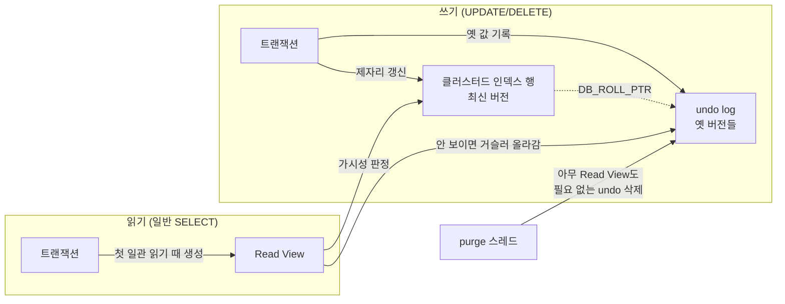

PostgreSQL과 가장 크게 다른 점은 **최신 버전이 테이블에 있고 옛 버전이 undo에 있다**는 것이다. PostgreSQL은 새 버전을 새 튜플로 테이블에 추가하고, 옛 튜플을 VACUUM이 치운다.

### 1. 행 하나의 모양: 숨은 컬럼

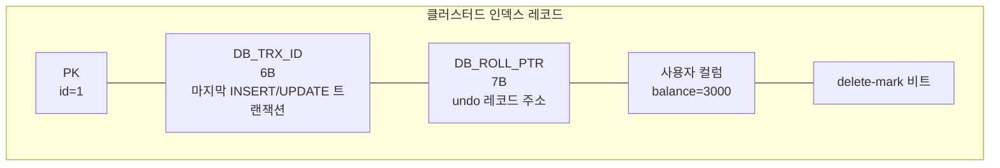

- `DB_TRX_ID`: 이 버전을 만든 트랜잭션 ID. DELETE도 내부적으로는 "delete-mark 비트를 켜는 UPDATE"여서 이 값이 바뀐다.
- `DB_ROLL_PTR`: 이 버전 직전 상태를 담은 undo 레코드의 주소. undo 레코드에도 다시 그 전 버전의 `DB_TRX_ID`·`DB_ROLL_PTR`이 들어 있어서 **버전 체인**이 만들어진다.
- `DB_ROW_ID`(6B)는 PK가 없어서 InnoDB가 숨은 클러스터드 인덱스를 만들 때만 붙는다.
- **세컨더리 인덱스에는 이 숨은 컬럼이 없다.** 그래서 세컨더리 인덱스의 MVCC는 6절처럼 따로 동작한다.

### 2. UPDATE 하면 무엇이 남나: 버전 체인

MVCC가 다른 트랜잭션에게 **옛 값**을 보여 주려면, 옛 값이 어딘가 남아 있어야 한다. 이 절은 UPDATE 한 번이 무엇을 남기는지만 본다.

**처음 상태.** 트랜잭션 101이 `id=1` 행을 넣고 커밋했다.

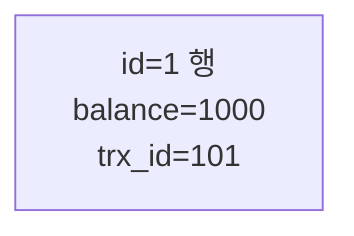

**UPDATE 한 번.** 트랜잭션 102가 `balance`를 2000으로 바꾼다. InnoDB는 세 가지를 한다.

1. 바꾸기 전 값(`balance=1000`, `trx_id=101`)을 **undo log에 복사**한다.
2. 테이블의 행을 **제자리에서** 2000으로 고친다.
3. 행의 `DB_TRX_ID`를 102로, `DB_ROLL_PTR`을 방금 만든 undo로 바꾼다.

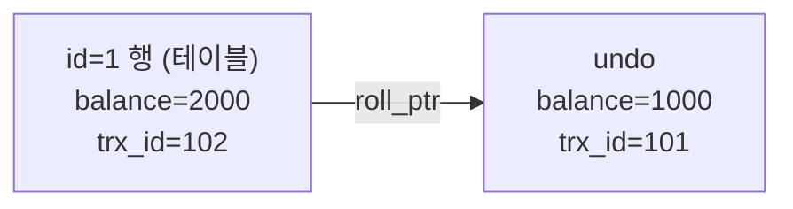

테이블에는 새 값 하나만 있고, 옛 값은 undo에 있다. 행에서 `roll_ptr`을 따라가면 옛 값을 찾을 수 있다.

**UPDATE 한 번 더.** 트랜잭션 103이 3000으로 바꾸고, **아직 커밋하지 않았다.** 같은 일이 한 번 더 일어나 고리가 하나 늘어난다.

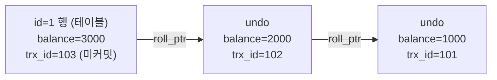

이렇게 **최신 → 과거로 이어진 고리**를 버전 체인이라 한다. 다른 트랜잭션이 이 행을 읽을 때, 103의 값(3000)을 보면 안 되는 상황이면 체인을 한 칸 거슬러 올라가 2000을 읽는다. 어느 버전까지 올라갈지 정하는 규칙이 3·4절이다.

- 같은 행은 X 락 때문에 한 트랜잭션씩 차례로 고친다. 그래서 체인에서 커밋 안 된 버전은 맨 위 하나뿐이다.
- undo는 행 전체가 아니라 **바뀐 컬럼의 옛 값**만 기록한다. 옛 버전은 최신 행에 undo를 거꾸로 적용해 재구성한다.
- INSERT가 남기는 undo는 커밋하면 바로 버린다. 삽입 전에는 행이 없었으니 옛 버전을 볼 트랜잭션도 없다. UPDATE/DELETE의 undo는 커밋 뒤에도 남아 purge를 기다린다 (8절).

### 3. Read View: 스냅샷 순간의 "진행 중 명단"

Read View는 "**이 순간 아직 커밋 안 한 트랜잭션이 누구인가**"를 찍어 둔 사진이다.

먼저 알아 둘 것: 트랜잭션 ID는 `BEGIN` 때가 아니라 **처음 행을 바꾸거나 잠글 때** 받는다. 그래서 ID 순서는 "첫 쓰기를 시작한 순서"이고, **커밋 순서와는 다르다.** 읽기만 하는 트랜잭션은 ID가 없다.

#### 예시

트랜잭션 넷과 읽는 트랜잭션 R이 있다.

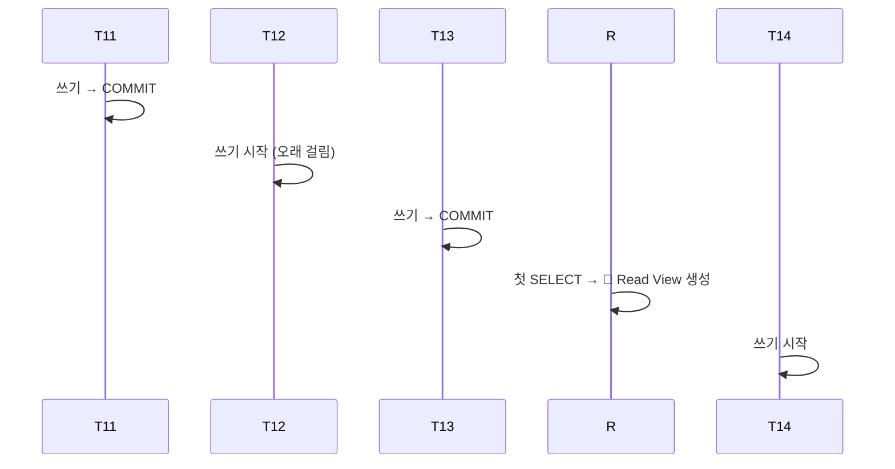

📸 순간의 상태와 Read View 값:

| 트랜잭션 | 📸 순간 상태 | R에게 보이나 |
|---|---|---|
| T11 | 이미 커밋 | ✅ |
| T12 | 진행 중 | ❌ |
| T13 | 이미 커밋 (T12보다 **늦게 시작했지만 먼저 끝남**) | ✅ |
| T14 | 아직 ID 없음 (📸 뒤에 시작) | ❌ |

| 필드 (InnoDB 소스) | 뜻 | 값 |
|---|---|---|
| `m_ids` | 📸 순간 진행 중이던 트랜잭션 ID 목록 | {12} |
| `m_up_limit_id` | **하한 = 진행 중인 가장 작은 ID** (`min(m_ids)`). 이보다 작은 ID는 전부 완료됐다. 진행 중이 없으면 상한과 같다 | 12 |
| `m_low_limit_id` | **상한 = 📸 순간 다음에 배정할 ID** (지금까지 준 가장 큰 ID + 1). 이 값 이상은 📸 뒤에 ID를 받았다 | 14 |
| `m_creator_trx_id` | R 자신의 ID. 자기 변경은 항상 보인다 | 0 (아직 안 씀) |

이름이 직관과 반대다. **`up`이 하한, `low`가 상한**이다.

하한을 "완료된 가장 큰 ID"로 오해하기 쉽다. 이 예시에서 완료된 가장 큰 ID는 13이지만 하한은 12다. 13을 하한으로 쓰면 "13 미만은 보임"이 되어 진행 중인 T12를 읽어 버린다. 하한은 **"여기 아래로는 진행 중인 게 하나도 없다"는 경계**다.

> 상한은 정확히는 "다음에 줄 번호"다. MySQL 8.0부터 트랜잭션 ID와 커밋 번호가 같은 카운터를 써서 번호가 건너뛸 수 있다. 그래도 "이 값 이상은 📸 뒤에 받은 ID"라는 뜻은 같다.

#### 왜 명단이 필요한가

ID를 수직선에 놓으면 세 구역이 생긴다.

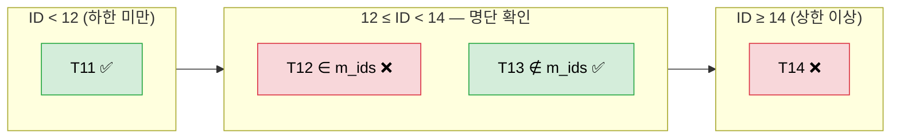

가운데 구역에 **진행 중인 T12와 이미 커밋한 T13이 섞여 있다.** 숫자 하나로 자르면 둘 중 하나를 틀린다.

- "12 이상은 안 보임"으로 자르면 커밋된 T13을 놓친다.
- "14 미만은 보임"으로 자르면 커밋 안 된 T12를 읽는다 (dirty read).

그래서 가운데 구역만 `m_ids`를 찾아본다. 하한·상한은 대부분의 행을 명단 검색 없이 판정하는 지름길이다.

명단은 📸 순간의 **복사본**이다. 뒤에 T12가 커밋해도 R의 `m_ids`에서 빠지지 않는다. RR에서 같은 SELECT가 같은 결과를 내는 이유다 (5절). 명단 복사와 커밋은 같은 뮤텍스 아래서 일어나므로, 📸 순간 모든 트랜잭션은 "명단에 있음"과 "이미 커밋" 중 하나다.

### 4. 가시성 판정과 체인 거슬러 오르기

행을 읽을 때 그 버전의 `DB_TRX_ID`로 아래 판정을 하고, 안 보이면 `DB_ROLL_PTR`을 따라 한 단계 옛 버전으로 가서 다시 판정한다.

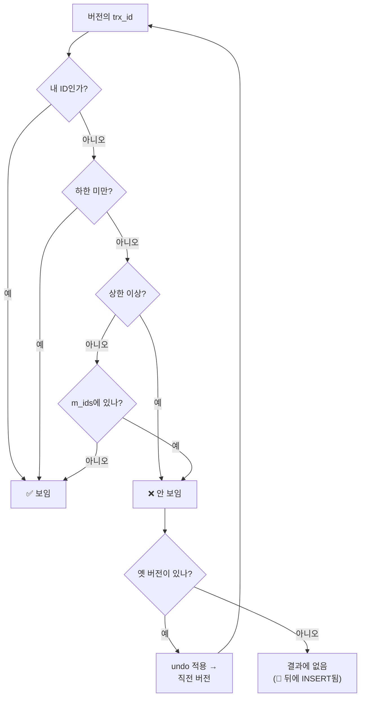

보이는 버전이 delete-mark 상태면 결과에서 뺀다 (📸 전에 삭제된 행).

#### 예시: 2절의 체인 읽기

2절의 `id=1` 행을, 트랜잭션 103이 고치는 중(미커밋)일 때 찍은 Read View(`m_ids={103}`, 하한 103, 상한 104)로 읽는다.

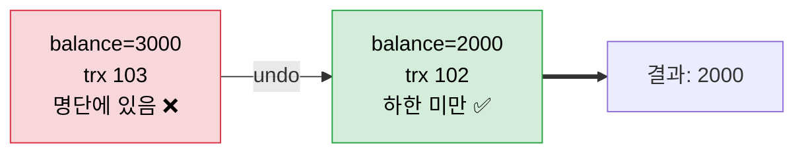

체인이 길수록 읽기 한 번에 undo를 여러 번 적용한다. **긴 트랜잭션이 읽기를 느리게 하는 이유**가 이것이다 (8절).

#### "내 ID인가?"를 먼저 보는 이유

3절 예시에서 R이 SELECT 뒤에 UPDATE를 하면 그때 ID를 받는다. 14는 이미 T14가 가져갔으니 R의 ID는 15 이상이고, 이는 **R 자신의 상한(14) 이상**이다. "내 ID인가?" 확인이 없으면 R이 고친 행이 R에게 안 보인다. 7절의 "UPDATE한 행이 갑자기 보이는" 현상도 이 규칙에서 나온다.

### 5. 격리 수준은 "Read View를 언제 만드느냐"의 차이

| 격리 수준 | Read View를 만드는 때 | 결과 |
|---|---|---|
| READ UNCOMMITTED | 만들지 않음. 항상 최신 버전을 읽음 | dirty read |
| READ COMMITTED | **문장(SELECT)마다** 새로 | 문장 사이에 커밋된 값이 보임 |
| REPEATABLE READ (기본) | 트랜잭션의 **첫 일관 읽기 때 한 번** | 트랜잭션 끝까지 같은 값 |
| SERIALIZABLE | (autocommit이 꺼져 있으면) 일반 SELECT도 `FOR SHARE`로 바뀌어 잠금 읽기 | MVCC 대신 락 |

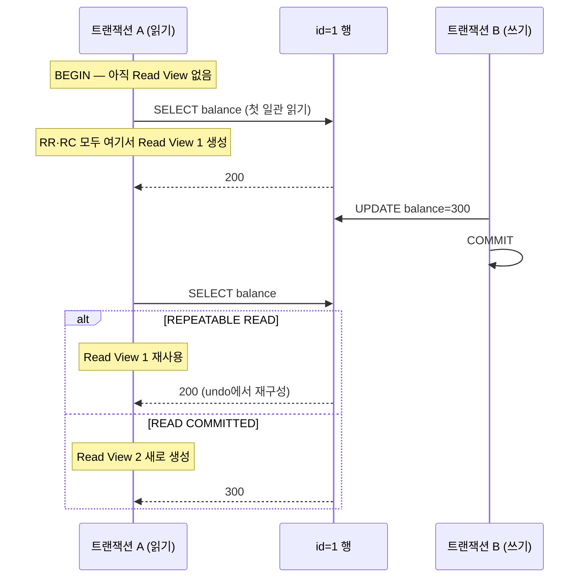

- RR의 스냅샷 시점은 `BEGIN`이 아니라 **첫 일관 읽기**다. `BEGIN` 직후에 스냅샷을 찍으려면 `START TRANSACTION WITH CONSISTENT SNAPSHOT`을 쓴다.
- RC가 문장마다 Read View를 새로 만들면 활성 트랜잭션이 바뀔 때마다 오래된 Read View가 사라진다. 그래서 RC가 purge에 덜 부담을 준다.

### 6. 세컨더리 인덱스의 MVCC

세컨더리 인덱스 레코드에는 `DB_TRX_ID`가 없고, **제자리 갱신도 하지 않는다.** 키가 바뀌면 옛 레코드를 delete-mark하고 새 레코드를 넣는다. 가시성은 페이지 헤더의 `PAGE_MAX_TRX_ID`(그 페이지를 마지막으로 고친 트랜잭션 중 가장 큰 ID)로 먼저 판단한다.

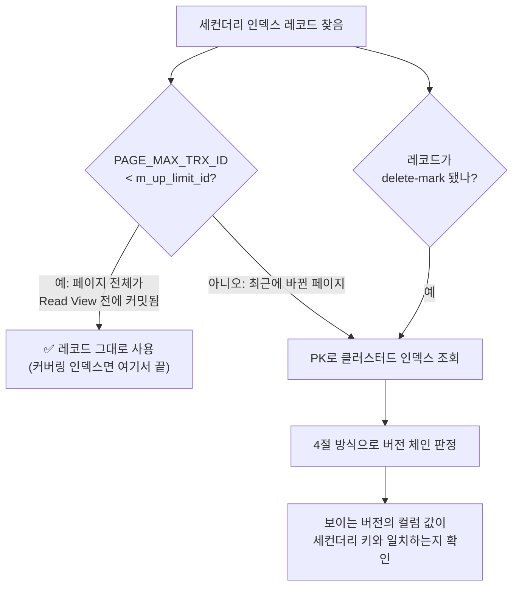

- 쓰기가 잦은 테이블에서는 **커버링 인덱스여도 클러스터드 인덱스를 다시 읽는** 일이 생긴다. `EXPLAIN`에 `Using index`가 떠도 실제로는 랜덤 I/O가 늘 수 있다.

### 7. 스냅샷 읽기와 현재 값 읽기가 섞일 때

Read View는 **일반 SELECT에만** 쓰인다. `UPDATE`·`DELETE`·`SELECT ... FOR UPDATE`는 Read View를 무시하고 **최신 커밋 버전**을 읽은 뒤 락을 건다 ([락 세트 5절](../../knowledge/database/0004-mysql-lock/02-overview.md#5-읽기의-두-종류)).

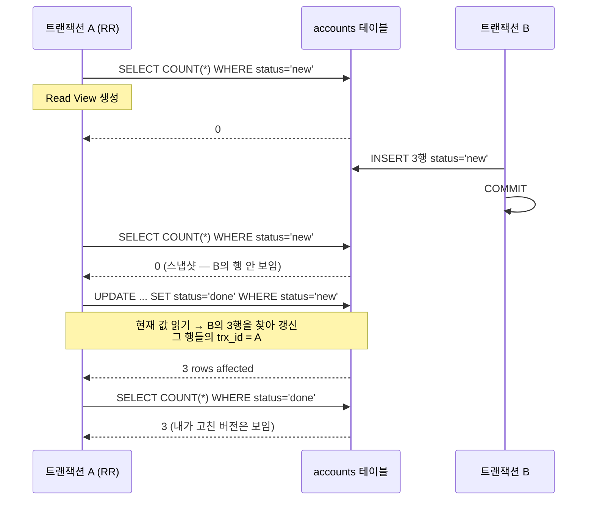

"아까는 0행이었는데 UPDATE는 3행을 바꿨다"는 일이 **RR에서도 정상 동작**이다. 읽고 → 판단하고 → 쓰는 로직이면 처음 읽기부터 `FOR UPDATE`로 하거나, 조건을 `UPDATE` 한 문장에 넣는다.

### 8. purge와 History List: 긴 트랜잭션이 왜 위험한가

커밋된 UPDATE/DELETE undo는 바로 지우지 못한다. **가장 오래된 Read View**가 그 undo를 아직 필요로 할 수 있어서다. purge 스레드는 가장 오래된 Read View를 기준으로, 그보다 앞서 커밋된 undo만 지운다.

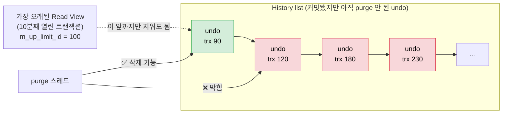

트랜잭션 하나가 열려 있는 동안 생기는 일:

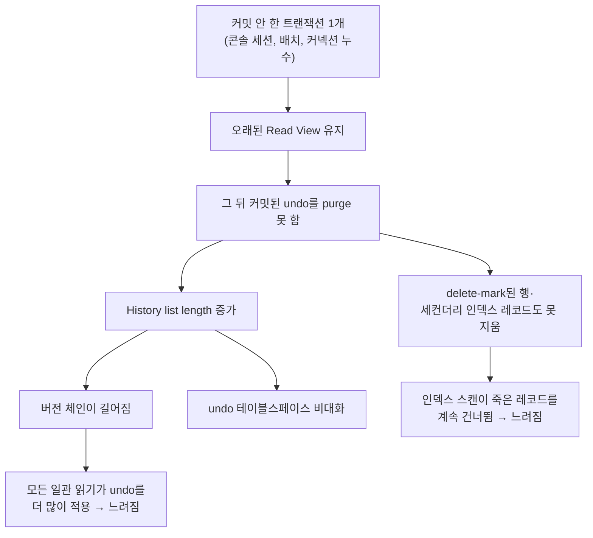

- 확인: `SHOW ENGINE INNODB STATUS\G`의 `History list length`, `information_schema.innodb_trx`를 `trx_started` 순으로 정렬해 오래된 트랜잭션 찾기.
- 대응: [MySQL 흔한 함정 — 긴 트랜잭션과 History List](../../knowledge/database/0001-mysql/04-pitfalls.md#3-긴-트랜잭션과-history-list). purge가 쓰기를 못 따라가면 `innodb_max_purge_lag`로 쓰기를 늦춰 균형을 맞출 수 있다.
- MySQL 8.0부터 undo는 시스템 테이블스페이스가 아니라 별도 undo 테이블스페이스에 있고, `innodb_undo_log_truncate`(기본 ON)로 커진 파일을 줄일 수 있다. 하지만 purge가 막혀 있으면 줄일 수도 없다.

### 9. DELETE된 행의 일생

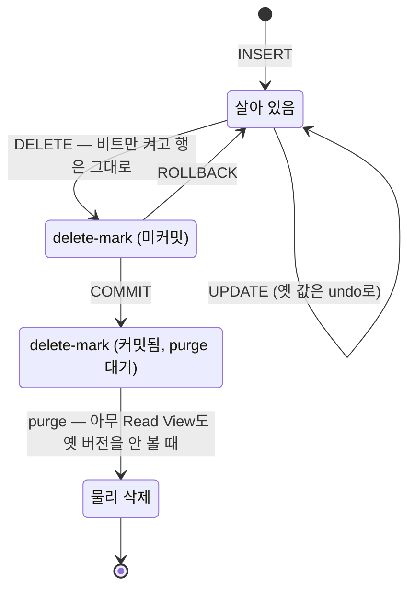

DELETE 직후에도 행은 페이지에 남아 있다. 옛 Read View로 읽는 트랜잭션은 이 행의 delete-mark 전 버전을 undo로 재구성해 계속 볼 수 있다.

### 10. PostgreSQL과 비교

| | InnoDB | PostgreSQL |
|---|---|---|
| 최신 버전 위치 | 테이블(클러스터드 인덱스)에 제자리 갱신 | 새 튜플을 테이블에 추가 |
| 옛 버전 위치 | undo log | 테이블 안의 죽은 튜플 |
| 버전 표시 | `DB_TRX_ID` + `DB_ROLL_PTR` | `xmin` / `xmax` |
| 정리 | purge 스레드 (자동) | VACUUM / autovacuum |
| 긴 트랜잭션의 피해 | History list 증가, 읽기 느려짐 | 죽은 튜플 누적(bloat), VACUUM이 못 지움 |
| 최신 값 읽기 비용 | 싸다 (최신이 바로 테이블에 있음) | 싸다 (가시 튜플 탐색) |
| 옛 값 읽기 비용 | undo 적용 횟수만큼 비쌈 | 튜플 자체를 읽으므로 상대적으로 쌈 |

PostgreSQL 쪽 가시성 규칙은 [PostgreSQL RR의 MVCC vs MySQL](./0007-postgresql-repeatable-read-mvcc-vs-mysql.md), 락과 정리 방식 차이는 [MySQL과 PostgreSQL의 락 처리 방식 차이](./0005-mysql-postgresql-lock-handling-differences.md)에서 다룬다.

### 정리

1. 모든 행은 `DB_TRX_ID`(누가)와 `DB_ROLL_PTR`(옛 버전 위치)를 가진다.
2. UPDATE·DELETE는 옛 값을 undo에 남기고 제자리에서 고친다. undo끼리 이어져 버전 체인이 된다.
3. 트랜잭션 ID는 첫 쓰기 때 받으므로 ID 순서와 커밋 순서가 다르다. 그래서 Read View는 하한·상한 두 숫자와 함께 스냅샷 순간 **진행 중이던 명단**(`m_ids`)을 복사해 둔다.
4. 일반 SELECT는 "내 ID → 하한 미만 → 상한 이상 → 명단에 있나" 순서로 각 버전을 판정하고, 안 보이면 체인을 거슬러 올라간다.
5. RR과 RC의 차이는 Read View를 한 번 만드느냐, 문장마다 만드느냐다.
6. 잠금 읽기·UPDATE는 Read View를 쓰지 않고 최신 커밋 버전을 읽는다.
7. 가장 오래된 Read View가 purge의 한계선이다. 긴 트랜잭션 하나가 서버 전체의 읽기를 느리게 만든다.

## 출처

- [MySQL 8.4 Reference Manual — 17.3 InnoDB Multi-Versioning](https://dev.mysql.com/doc/refman/8.4/en/innodb-multi-versioning.html)
- [MySQL 8.4 Reference Manual — 17.7.2.3 Consistent Nonlocking Reads](https://dev.mysql.com/doc/refman/8.4/en/innodb-consistent-read.html)
- [MySQL 8.4 Reference Manual — 17.8.9 Purge Configuration](https://dev.mysql.com/doc/refman/8.4/en/innodb-purge-configuration.html)
- [MySQL 8.4 Reference Manual — 17.6.6 Undo Logs](https://dev.mysql.com/doc/refman/8.4/en/innodb-undo-logs.html)
- [MySQL 8.4 Reference Manual — 10.5.3 Optimizing InnoDB Read-Only Transactions](https://dev.mysql.com/doc/refman/8.4/en/innodb-performance-ro-txn.html)
- [MySQL Server 8.4 source documentation — ReadView class](https://dev.mysql.com/doc/dev/mysql-server/8.4.4/classReadView.html)
