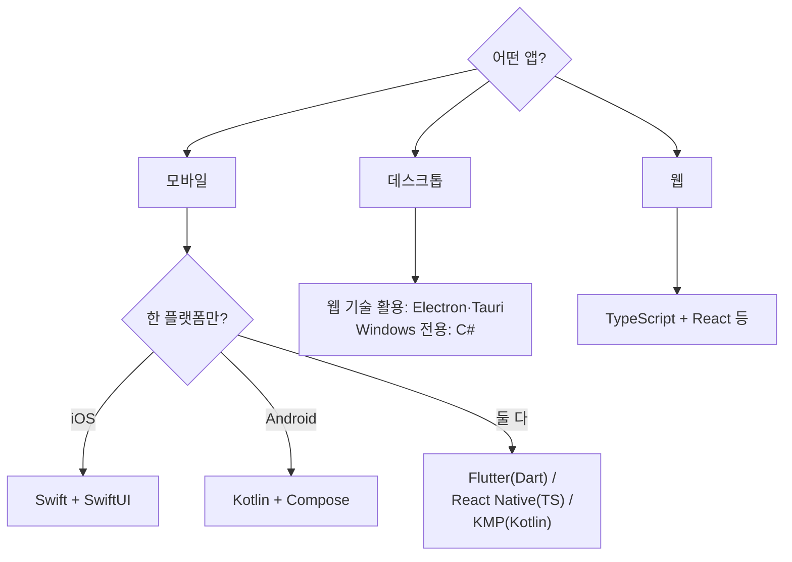

# 앱을 만드는 방법과 언어

## 쉬운 설명

앱 만들기는 집 짓기와 비슷하다. 그 동네(iOS·Android·Windows) 전용 자재로 지으면 가장 튼튼하지만 동네마다 따로 지어야 한다(네이티브). 공장에서 만든 조립식 집을 여러 동네에 그대로 세울 수도 있고(크로스 플랫폼), 집 대신 누구나 들어올 수 있는 천막을 칠 수도 있다(웹 앱). 어디에 지을지와 몇 동네에 지을지를 먼저 정하면, 쓸 언어는 거의 저절로 정해진다. 다 지은 집은 공인 분양 사무소(앱 스토어)를 통해 내놓거나 아는 사람에게 열쇠를 직접 건넬 수 있는데, 분양 사무소는 검사와 수수료가 있고 직접 건네는 쪽은 받을 수 있는 사람이 제한된다.

## 일반 설명

### 1. 먼저 정할 것: 어디서 돌아가는 앱인가

"앱"은 실행 위치에 따라 세 종류로 나뉜다. 언어는 이 선택에 따라온다.

| 종류 | 실행 위치 | 대표 예 |
|---|---|---|
| 모바일 앱 | iOS, Android | 카카오톡, 배달 앱 |
| 데스크톱 앱 | Windows, macOS, Linux | VS Code, Slack 데스크톱 |
| 웹 앱 | 브라우저 | Gmail, Notion 웹 |

대부분의 앱은 화면(클라이언트)만으로 끝나지 않고 데이터를 저장·처리하는 **서버(백엔드)**가 따로 필요하다. 서버 언어는 클라이언트와 별개로 고른다 (6절).

### 2. 만드는 방법 네 가지

| 방법 | 원리 | 장점 | 대가 |
|---|---|---|---|
| **네이티브** | 플랫폼 제조사가 정한 언어·UI로 플랫폼마다 따로 개발 | 성능·OS 기능 접근·사용감이 가장 좋다 | 플랫폼 수만큼 코드·인력이 든다 |
| **크로스 플랫폼** | 한 코드베이스를 여러 플랫폼용으로 빌드 | 코드 대부분을 공유, 개발비 절감 | 프레임워크 의존, 최신 OS 기능 반영이 늦을 수 있다 |
| **웹 기반 (웹 앱·PWA·하이브리드)** | HTML·CSS·JS로 만들고 브라우저나 웹뷰에서 실행 | 설치 없이 배포, 한 번 만들면 어디서나 | 기기 기능 접근·오프라인·성능에 한계 |
| **노코드·로우코드** | 화면을 끌어 놓아 조립 (FlutterFlow, Bubble 등) | 코딩 없이 빠른 시제품 | 복잡한 기능·확장·이전이 어렵다 |

### 3. 모바일 앱

#### 네이티브

| 플랫폼 | 언어 | UI 프레임워크 | 개발 도구 |
|---|---|---|---|
| iOS | **Swift** (예전 Objective-C) | SwiftUI, UIKit | Xcode (macOS 필수) |
| Android | **Kotlin** (예전 Java) | Jetpack Compose, XML View | Android Studio |

- iOS 앱은 Mac이 있어야 빌드·스토어 등록이 된다. 크로스 플랫폼을 써도 마찬가지다.
- Android는 Kotlin이 공식 우선 언어다. Java 지식은 그대로 쓸 수 있다 ([Java knowledge 세트](../../knowledge/java/0001-java/01-history.md)).

#### 크로스 플랫폼

| 프레임워크 | 언어 | 공유 범위 | 화면 그리는 방식 |
|---|---|---|---|
| **Flutter** (Google) | Dart | UI + 로직 | 자체 렌더링 엔진으로 직접 그림 → 플랫폼 간 모양이 똑같다 |
| **React Native** (Meta) | JavaScript / TypeScript | UI + 로직 | 플랫폼의 실제 네이티브 컴포넌트를 씀 |
| **Kotlin Multiplatform (KMP)** (JetBrains) | Kotlin | 로직만 공유, UI는 선택 | UI는 SwiftUI로 따로 짜거나 Compose Multiplatform으로 공유 |
| .NET MAUI (Microsoft) | C# | UI + 로직 | 네이티브 컴포넌트 |

- 점유율은 Flutter와 React Native가 크로스 플랫폼 시장의 대부분을 차지하고, KMP가 가장 빠르게 늘고 있다. 조사마다 수치가 달라 순위 정도만 참고한다.
- Compose Multiplatform의 iOS 지원은 1.8.0(2025년 5월)에서 Stable이 됐다. 같은 UI의 순수 SwiftUI 앱보다 iOS 앱 크기가 약 9MB 늘어난다(JetBrains 발표). 핵심 화면은 SwiftUI, 설정·폼 같은 보조 화면은 Compose로 섞어 쓰는 방식이 흔하다.
- 고르는 기준: 웹 프론트엔드(React) 경험이 있으면 React Native, 플랫폼 간 같은 디자인이 중요하면 Flutter, 이미 Android(Kotlin) 팀이 있고 네이티브 사용감을 유지하고 싶으면 KMP.

### 4. 데스크톱 앱

| 방법 | 언어 | 특징 |
|---|---|---|
| 네이티브 (Windows) | C# (WinUI, WPF), C++ | Windows 기능 접근이 가장 좋다 |
| 네이티브 (macOS) | Swift (SwiftUI, AppKit) | iOS와 코드 일부 공유 가능 |
| **Electron** | JavaScript / TypeScript (+ Node.js) | Chromium을 앱에 통째로 넣는다. VS Code·Slack·Discord가 사용. 생태계가 가장 크지만 용량·메모리가 크다 |
| **Tauri** | 화면은 웹 기술, 백엔드는 Rust | OS의 웹뷰를 써서 앱이 작다. 2.x부터 iOS·Android도 지원 |
| Qt | C++ / Python | 산업용·임베디드에서 오래 쓰임 |
| Flutter, Compose Multiplatform | Dart, Kotlin | 모바일 코드를 데스크톱까지 확장 |

- 크기 비교 예: 한 2026년 벤치마크에서 같은 앱이 Tauri 57MB, Electron 323MB였다. 측정 조건에 따라 차이 폭은 다르다.

### 5. 웹 앱

| 계층 | 언어 | 대표 도구 |
|---|---|---|
| 화면 구조·스타일 | HTML, CSS | Tailwind CSS |
| 동작 | JavaScript / **TypeScript** | React, Vue, Svelte, Angular |
| 풀스택 프레임워크 | TypeScript | Next.js, Nuxt, SvelteKit |

- **PWA**(Progressive Web App): 웹 앱을 홈 화면에 설치하고 오프라인·푸시 알림을 쓸 수 있게 한 것. 스토어 없이 배포할 수 있지만 iOS에서는 기능 제약이 남아 있다.
- **하이브리드**(Capacitor, Ionic): 웹 앱을 네이티브 앱 껍데기(웹뷰)에 넣어 스토어에 올린다.
- 브라우저에서 돌아가는 언어는 사실상 JavaScript(와 WebAssembly)뿐이라 웹 앱 화면은 언어 선택지가 거의 없다.

### 6. 서버(백엔드) 언어

앱이 로그인·데이터 저장·결제를 하려면 서버가 필요하다.

| 언어 | 대표 프레임워크 | 많이 쓰는 곳 |
|---|---|---|
| Java / Kotlin | Spring Boot | 국내 기업·금융, 대규모 서비스 |
| JavaScript / TypeScript | Node.js (Express, NestJS) | 스타트업, 프론트엔드와 언어 통일 |
| Python | Django, FastAPI | AI·데이터 연동 서비스 |
| Go | 표준 라이브러리, Gin | 클라우드 인프라, 고성능 API |
| C# | ASP.NET Core | Microsoft 생태계 |

- 서버를 직접 만들지 않으려면 **BaaS**(Firebase, Supabase)로 인증·DB·저장소를 빌려 쓸 수 있다.

### 7. 배포: 스토어에 올리기 vs 직접 설치해 쓰기

앱을 만든 뒤 사용자에게 전달하는 길은 크게 둘이다. **스토어 배포**(App Store·Google Play에 올려 누구나 받게)와 **직접 배포**(스토어를 거치지 않고 설치 파일·링크·웹 주소로 나눠 주기)다. 핵심 차이는 **누가 설치를 허락하느냐**다 — 스토어는 플랫폼 회사가 심사하고, 직접 배포는 만든 사람이 책임진다.

#### 비교

| | 스토어 배포 | 직접 배포 |
|---|---|---|
| 설치 대상 | 전 세계 누구나 검색해 설치 | 링크·파일을 받은 사람만 |
| 심사 | 있음 (반려 가능) | 없음, 대신 OS의 설치 제한을 받는다 |
| 업데이트 | 스토어가 자동 업데이트 | 직접 업데이트 수단을 만들어야 한다 |
| 결제 | 스토어 결제 수수료 (통상 15~30%) | 자체 결제 가능 |
| 비용 | Apple $99/년, Google $25(1회) | 플랫폼별로 다름 (아래) |
| 신뢰·발견 | 사용자가 믿고 설치, 검색 노출 | 설치 경고·사용자 설득이 필요 |
| 맞는 경우 | 일반 사용자 대상 서비스 | 사내 업무 앱, 테스트, 개인용 도구 |

#### 직접 배포 방법과 한계 — 플랫폼별

| 플랫폼 | 방법 | 한계 |
|---|---|---|
| **iOS** | TestFlight (베타) | 외부 테스터 최대 10,000명, 빌드는 90일 뒤 만료 → 정식 배포 수단이 아니다 |
| | Ad Hoc | 기기 UDID를 미리 등록, 기기 종류별 연 100대 |
| | Enterprise 프로그램 ($299/년) | **자사 직원 전용**. 일반 사용자 배포에 쓰면 인증서가 취소될 수 있다 |
| | Apple Business Manager 커스텀 앱 | 특정 기관에만 비공개 배포, Apple 심사는 받는다 |
| | 대체 마켓·웹 배포 | **EU에서만** 가능 (DMA). 미국·한국은 App Store가 사실상 유일한 일반 배포 경로 |
| **Android** | APK 파일 직접 설치(사이드로딩) | "출처를 알 수 없는 앱" 허용이 필요, 사용자 경고 |
| | 개발자 인증 의무화 | 2026-09-30부터 브라질·인도네시아·싱가포르·태국에서 시작, **2027년 전 세계로 확대** 예정. 인증 안 된 개발자 앱은 ADB나 별도 고급 설치 절차(대기 시간 포함)로만 설치된다. 취미 개발자용 계정은 최대 20대까지 신분증·비용 없이 배포 |
| **데스크톱** | 설치 파일(.exe, .dmg) 배포 | 코드 서명을 안 하면 Windows SmartScreen·macOS Gatekeeper 경고. macOS는 Apple 공증(notarization)이 사실상 필수 |
| **웹(PWA)** | URL 공유, 홈 화면에 추가 | 아래 PWA 한계 참고 |

#### 스토어 배포의 한계

- **심사**: Apple은 정책 위반·기능 부족(웹사이트를 감싸기만 한 앱 등)으로 반려한다. 수정·재심사로 출시가 늦어질 수 있다.
- **Google Play 신규 개인 계정**: 2023-11-13 이후 만든 개인 계정은 정식 출시 전에 **테스터 12명 이상이 14일 연속 참여한 비공개 테스트**를 거쳐야 한다. 조직 계정은 면제.
- **수수료**: 디지털 상품(구독·아이템)은 스토어 결제를 쓰면 수수료가 붙는다. 실물 상품·서비스(쇼핑, 배달)는 대상이 아니다.
  - EU: 2026-10-01부터 App Store 인앱 결제 26%, 자체 결제 20%, 외부 링크 결제 15%(할인 프로그램 10%), 대체 마켓·웹 배포는 5% 수수료(Core Technology Commission).
  - 미국: 외부 웹 결제 링크는 허용되지만 대체 앱 마켓은 없다.
  - 한국: 법으로 제3자 결제를 허용하지만, 그 경우에도 26% 안팎의 수수료가 붙는다.
- **플랫폼 정책 변화에 종속**: 정책이 바뀌면 앱을 고쳐야 하고, 계정이 정지되면 배포 수단을 통째로 잃는다.

#### PWA(웹 앱을 앱처럼 설치)의 한계

스토어 없이 배포하는 가장 쉬운 길이지만, 특히 iOS에서 제약이 크다.

| 기능 | Android (Chrome) | iOS (Safari) |
|---|---|---|
| 설치 안내 | 설치 버튼 자동 표시 | 사용자가 공유 → "홈 화면에 추가"를 직접 해야 한다 |
| 푸시 알림 | 가능 | iOS 16.4+에서 **홈 화면에 추가한 경우만** |
| 백그라운드 동기화 | 가능 | 지원 안 함 — 앱을 닫으면 갱신·업로드 재시도 불가 |
| 블루투스·NFC·USB | 일부 가능 | 지원 안 함 |
| 다른 브라우저 | 엔진별로 다름 | iOS의 모든 브라우저가 Safari 엔진을 써서 같은 제약 |

#### 정리: 어떻게 배포할까

| 상황 | 권장 |
|---|---|
| 일반 소비자 대상 서비스 | 스토어 배포 (iOS는 사실상 필수) |
| 사내 직원만 쓰는 업무 앱 | iOS: Apple Business Manager·Enterprise / Android: 사내 MDM·APK / 또는 PWA |
| 출시 전 테스트 | TestFlight, Google Play 비공개 테스트 |
| 나 혼자 또는 지인 몇 명만 | Android APK, iOS는 Xcode로 내 기기에 직접 설치(무료 계정은 7일마다 재설치) |
| 설치 부담 없이 빨리, 기기 기능은 많이 안 씀 | PWA·웹 앱 |

### 8. 무엇부터 배우나

| 상황 | 추천 |
|---|---|
| 처음 배우고, 웹·모바일 모두 해보고 싶다 | **TypeScript** — 웹(React), 모바일(React Native), 데스크톱(Electron), 서버(Node.js)를 한 언어로 |
| 모바일 앱 하나를 iOS·Android 둘 다 빨리 내고 싶다 | **Flutter (Dart)** |
| Android·서버(Spring)를 함께 하고 싶다 | **Kotlin** — Android, 서버, KMP까지 이어진다 |
| iPhone 앱 품질이 최우선이다 | **Swift** |
| 시제품만 빨리 보고 싶다 | 노코드 (FlutterFlow 등) 후 필요하면 코드로 이전 |

## 출처

- [Appfigures — React Native's New Rival Is Quietly Eating Its Lunch (2025-12)](https://appfigures.com/resources/insights/20251219?f=4)
- [Adapty — Most popular mobile app development frameworks in 2026](https://adapty.io/blog/mobile-app-development-frameworks)
- [Tech Insider — Kotlin Multiplatform vs Flutter vs React Native 2026](https://tech-insider.org/kotlin-multiplatform-vs-flutter-vs-react-native-2026/)
- [JetBrains — Compose Multiplatform 1.8.0: iOS is Stable](https://blog.jetbrains.com/kotlin/2025/05/compose-multiplatform-1-8-0-released-compose-multiplatform-for-ios-is-stable-and-production-ready/)
- [JetBrains — Compose Multiplatform 1.11.0 (2026-05)](https://blog.jetbrains.com/kotlin/2026/05/compose-multiplatform-1-11-0)
- [Better Stack — Tauri vs Electron vs Deno Desktop vs Electrobun](https://betterstack.com/community/guides/scaling-nodejs/tauri-vs-electron-vs-deno-vs-electrobun/)
- [Tech Insider — Tauri vs Electron 2026](https://tech-insider.org/tauri-vs-electron-2026/)
- [Android Developers Blog — Android developer verification rolling out to all developers (2026-03)](https://android-developers.googleblog.com/2026/03/android-developer-verification-rolling-out-to-all-developers.html)
- [Android Authority — Android sideloading changes timeline](https://www.androidauthority.com/android-sideloading-changes-timeline-3679204/)
- [Google Play Console Help — 신규 개인 계정 테스트 요건](https://support.google.com/googleplay/android-developer/answer/14151465)
- [The Next Web — Apple EU App Store fees, Core Technology Commission (2026-08)](https://thenextweb.com/news/apple-eu-app-store-fees-dma-core-technology-commission)
- [Foresight Mobile — iOS App Distribution Guide 2026](https://foresightmobile.com/blog/ios-app-distribution-guide-2026)
- [Apple — Deployment guide: 앱 배포 방식](https://support.apple.com/guide/deployment/depce7cefc4d/web)
- [MagicBell — PWA iOS Limitations and Safari Support](https://www.magicbell.com/blog/pwa-ios-limitations-safari-support-complete-guide)
- [firt.dev — iOS PWA Compatibility](https://firt.dev/notes/pwa-ios/)
