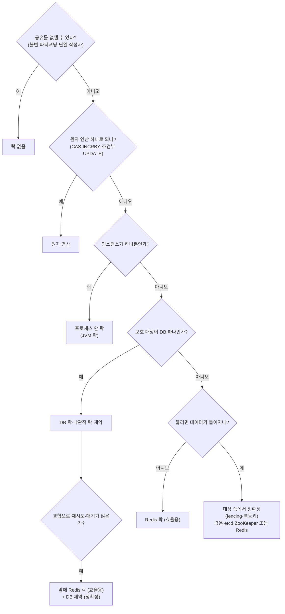

# 락 트레이드오프와 선택 기준

## 쉬운 설명

열쇠 하나로 가게 전체를 잠그면 안전하지만 손님이 한 명씩만 들어온다. 방마다 열쇠를 두면 여럿이 들어오지만, 두 방을 동시에 쓰려던 두 사람이 서로의 열쇠를 쥐고 멈출 수 있다. 여러 건물이 함께 쓰는 열쇠함은 어디서든 쓸 수 있지만 가지러 가는 길이 멀고, 가는 길에 넘어진 사람의 열쇠는 시간이 지나야 돌아온다. 락을 고른다는 것은 **안전, 속도, 거리** 중 무엇을 내줄지 고르는 일이다.

## 일반 설명

> 동작 원리는 [개요](./02-overview.md), 고른 뒤 실수는 [흔한 함정](./04-pitfalls.md), 장애는 [장애 유형](./05-failure-modes.md). 이 문서는 솔루션을 가리지 않는 선택 기준을 다룬다. 솔루션 안의 선택(격리 수준, TTL, `synchronized` vs `ReentrantLock`)은 [MySQL 락](../../database/0004-mysql-lock/03-tradeoffs.md), [Redis 락](../../database/0005-redis-lock/03-tradeoffs.md), [Java 락](../../java/0002-java-lock/03-tradeoffs.md).

### 1. 핵심 설계 선택: 얻은 것과 포기한 것

| 설계 선택 | 얻은 것 | 포기한 것 |
|---|---|---|
| **비관적 (먼저 잠금)** | 충돌이 잦아도 재시도 없이 한 번에 성공. 코드가 직관적 | 충돌이 없어도 대기·락 관리 비용을 늘 냄. 데드락 가능 |
| **낙관적 (쓸 때 검사)** | 충돌이 드물면 대기 0 | 충돌이 잦으면 재시도가 폭증해 비관적보다 느려짐. 실패 처리 코드 필요 |
| **굵은 단위** (전역·테이블) | 추론이 쉽고 데드락이 없음 | 처리량이 임계 구역 하나의 속도로 묶임 |
| **잘게 쪼갠 단위** (행·키) | 병렬성 | 여러 개를 잡을 때 순서 관리, 락 메모리·관리 비용 |
| **스핀 대기** | 짧은 임계 구역에서 문맥 전환(수 µs) 회피 | 길어지면 CPU만 태움 |
| **블록 대기** (park, 대기 큐) | CPU를 놓음 | 깨우는 비용, 보유자가 멈추면 대기자 누적 |
| **공정 (도착 순서)** | 기아 없음, 꼬리 지연 안정 | 처리량 감소 — 깨어나는 스레드만 들어갈 수 있어 끼어들기 이득을 잃음 |
| **lease (시간 제한 보유)** | 보유자가 죽어도 자동 해제 | 보유자가 **멈추면** 두 보유자가 생김 → fencing 필요 |
| **strict 2PL** (커밋까지 보유) | 커밋 안 된 값을 남이 못 씀, 직렬화 | 트랜잭션이 길면 락도 오래 쥠 |
| **predicate 대신 레코드 기준 범위 잠금** | 충돌 판정이 "같은 레코드인가"로 단순·빠름 | 조건보다 넓게 잠김 → [MySQL 락 범위](../../database/0004-mysql-lock/02-overview.md#4-락-범위는-어떻게-정해지나-repeatable-read) |

### 2. 수치로 보는 비용

| 수단 | 획득 비용 (대략적 크기) | 의미 |
|---|---|---|
| CAS 한 번 (경합 없음) | 수~수십 ns | 락보다 싸지만 변수 하나에 한정 |
| JVM 락 (경합 없음) | 수십 ns | 경합이 없으면 사실상 무료 |
| JVM 락 (경합, 블록) | 문맥 전환 수 µs | 경합이 처리량을 결정 |
| Redis 락 | 네트워크 왕복 1번, 같은 데이터센터 0.2~1ms | JVM 락보다 1만 배 이상 느림 |
| DB 행 락 | 트랜잭션 안 왕복 + 커밋 fsync, 수 ms | 커넥션·트랜잭션을 쥐는 시간이 함께 늘어남 |
| etcd·ZooKeeper | 합의 왕복 + 디스크 fsync, 수~수십 ms | 가장 느리지만 장애 중에도 순서 보장 |

- **경합된 락 하나의 처리량 상한 = 1 / 임계 구역 시간.** 임계 구역이 1ms면 코어가 몇 개든 초당 1,000번이 한계다. DB의 핫 로우가 이 경우다 → [MySQL 락 수치](../../database/0004-mysql-lock/03-tradeoffs.md#2-수치로-보는-비용).
- 그래서 층을 올릴수록(스레드 → DB → 분산) 락을 **덜 자주, 짧게** 잡도록 설계를 바꿔야 한다.

### 3. 효율용인가, 정확성용인가

분산 락을 고르기 전에 가장 먼저 답할 질문이다 (Kleppmann의 구분). 스레드·DB 락은 장애 중에도 상호 배제가 유지되므로 이 구분이 거의 필요 없고, **lease로 해제를 보장하는 락**에서 중요해진다.

| | 효율용 (efficiency) | 정확성용 (correctness) |
|---|---|---|
| 목적 | 같은 일을 여러 번 하지 않게 | 동시에 실행되면 데이터가 틀어짐 |
| 락이 가끔 뚫리면 | 비용이 조금 늘어남 (중복 계산, 알림 2번) | 이중 결제, 재고 음수, 데이터 손상 |
| 예 | 스케줄러 배치, 캐시 재계산, 외부 API 호출 절약 | 결제·정산, 재고 차감, 계좌 이체 |
| 맞는 수단 | Redis 단일 인스턴스 락으로 충분 | DB 트랜잭션·제약, 또는 etcd·ZooKeeper **+ fencing token**, 멱등키 |

정확성용인데 TTL 락만 쓰고 있다면 그 락은 최적화일 뿐이고, 진짜 안전장치는 보호 대상 쪽(DB 제약, 조건부 UPDATE, fencing 검사)에 있어야 한다.

### 4. 대안 비교

| 수단 | 층 | 장애 중 상호 배제 | 강점 | 대가 | 자세히 |
|---|---|---|---|---|---|
| **공유 없애기** (불변 객체, 키 파티셔닝, 단일 작성자) | 설계 | 필요 없음 | 락 비용 0, 데드락 없음 | 설계 제약, 재분배 비용 | — |
| **원자 연산** (CAS, `INCRBY`, 원자적 UPDATE) | 전 층 | 연산 하나는 보장 | 락보다 짧고 데드락 없음 | 연산 하나로 표현될 때만 | [MySQL 대안](../../database/0004-mysql-lock/03-tradeoffs.md#3-대안-비교-동시-수정-제어-방법) |
| **JVM 락** | 한 프로세스 | 보장 | 가장 빠름 | 서버 2대부터 무의미 | [Java 락](../../java/0002-java-lock/03-tradeoffs.md) |
| **DB 비관적 락** (`FOR UPDATE`) | DB | 트랜잭션 안에서 보장 | 데이터와 같은 곳, fencing 불필요 | 트랜잭션 길이만큼 보유, 데드락 | [MySQL 락](../../database/0004-mysql-lock/03-tradeoffs.md) |
| **낙관적 락** (`version`) | DB | 충돌 시 한쪽 실패 | 대기 없음, 버전이 곧 fencing | 고경합 시 재시도 폭증 | [MySQL 대안](../../database/0004-mysql-lock/03-tradeoffs.md#3-대안-비교-동시-수정-제어-방법) |
| **유니크 제약·멱등키** | DB | DB가 보장 | "한 번만 실행"을 가장 확실하게 | 표현 가능한 경우만 | — |
| **DB 이름 락** (`GET_LOCK`, advisory lock) | DB 세션 | 세션 동안 보장 | DB만 있으면 됨 | 커넥션에 묶임, 장애 조치 시 사라짐 | [MySQL 대안](../../database/0004-mysql-lock/03-tradeoffs.md#3-대안-비교-동시-수정-제어-방법) |
| **Redis 락** | 분산 | 장애 조치·멈춤 시 뚫릴 수 있음 | sub-ms, 구현 쉬움 | 정확성은 보장 못 함 | [Redis 락](../../database/0005-redis-lock/03-tradeoffs.md) |
| **etcd·ZooKeeper** | 분산 | 과반 합의로 보장, 순번으로 fencing | 정확성용 조정·리더 선출 | 별도 클러스터, 수 ms | [Redis 락 — 대안 비교](../../database/0005-redis-lock/03-tradeoffs.md#3-대안-비교) |

### 5. 주요 선택지: 어느 층에서 막을까

- 위에서부터 묻는 이유: 위쪽일수록 싸고, 장애가 적고, 데드락이 없다.
- **보호 대상과 같은 곳에서 막는 것**이 원칙이다. 데이터가 DB에 있으면 DB 안에서 막는 것이 DB 밖 락 + DB보다 단순하고 정확하다.
- **정확성을 맡을 곳을 먼저 정하고, 앞에 덧대는 락은 그다음이다.** DB 제약·fencing·멱등키가 정확성을 맡고 있으면 그 앞의 Redis 락은 뚫려도 재시도만 늘어난다. 정확성까지 Redis 락에 맡기면 TTL 만료·장애 조치 때 이중 처리가 그대로 남는다 → [원장 — 분산 락이 뚫려도 정확하게](../../database/0006-ledger/03-tradeoffs.md#3-동시성-제어-분산-락이-뚫려도-정확하게).

### 6. 쓰지 말아야 할 때

| 상황 | 이유 | 대신 |
|---|---|---|
| 원자 연산 하나로 표현됨 | 락은 더 길고 데드락 가능 | CAS, `INCRBY`, 조건부 UPDATE |
| 읽기만 많음 | 읽기 락도 비용 | MVCC 스냅샷, 불변 스냅샷, copy-on-write |
| 서버가 여러 대인데 프로세스 안 락 | 서로 모름 | DB 또는 분산 락 |
| 정확성이 필요한데 TTL 락만 | 멈춘 보유자 문제로 뚫림 | DB 제약, fencing, 멱등키 |
| 보유 시간이 수 분 이상 | 대기 누적, lease 관리 어려움 | 작업 상태 테이블(상태 컬럼 + 조건부 갱신), 워크플로 엔진 |
| 한 키에 초당 수천 번 경합 | 처리량 상한 = 1 / 임계 구역 | 파티셔닝, 큐로 직렬화, 집계 분산(`LongAdder`, 카운터 샤딩) |

### 7. 선택 체크리스트

1. **락이 뚫리면 무슨 일이 생기나?** 비용 증가 → 효율용. 데이터 손상 → 정확성용(DB·합의·fencing).
2. **락 없이 되나?** 공유 제거 → 원자 연산 → 그다음에 락.
3. **누구 사이의 상호 배제인가?** 스레드 / 트랜잭션 / 서버 — 층이 락을 정한다.
4. **보호 대상은 어디에 있나?** 그곳에서 막는다.
5. **충돌이 잦은가?** 잦으면 비관적, 드물면 낙관적.
6. **보유자가 죽거나 멈추면 어떻게 풀리나?** 해제 보장 방식과 그 대가(이중 보유)를 확인한다.
7. **여러 락을 함께 잡나?** 순서를 정한다 → [흔한 함정](./04-pitfalls.md#2-락-순서가-제각각-실수).

## 관련 문서

- [락의 역사](./01-history.md)
- [락 개요와 공통 구조](./02-overview.md)
- [락 사용 시 흔한 함정과 해결 방법](./04-pitfalls.md)
- [락 장애 유형과 대응](./05-failure-modes.md)
- [Java 락 트레이드오프](../../java/0002-java-lock/03-tradeoffs.md)
- [MySQL 락 트레이드오프](../../database/0004-mysql-lock/03-tradeoffs.md)
- [Redis 락 트레이드오프](../../database/0005-redis-lock/03-tradeoffs.md)

## 참고 자료

- [Martin Kleppmann — How to do distributed locking](https://martin.kleppmann.com/2016/02/08/how-to-do-distributed-locking.html)
- [antirez — Is Redlock safe?](https://www.antirez.com/news/101)
- [Kung, Robinson — On Optimistic Methods for Concurrency Control](https://www.eecs.harvard.edu/~htk/publication/1981-tods-kung-robinson.pdf)
- [Gray 등 — Granularity of Locks in a Large Shared Data Base](https://www.cs.purdue.edu/homes/bb/cs542-20Spr/readings/cc/granularity-locks.pdf)
- [Locks, leases, fencing tokens — Surfing Complexity](https://surfingcomplexity.blog/2025/03/03/locks-leases-fencing-tokens-fizzbee/)
