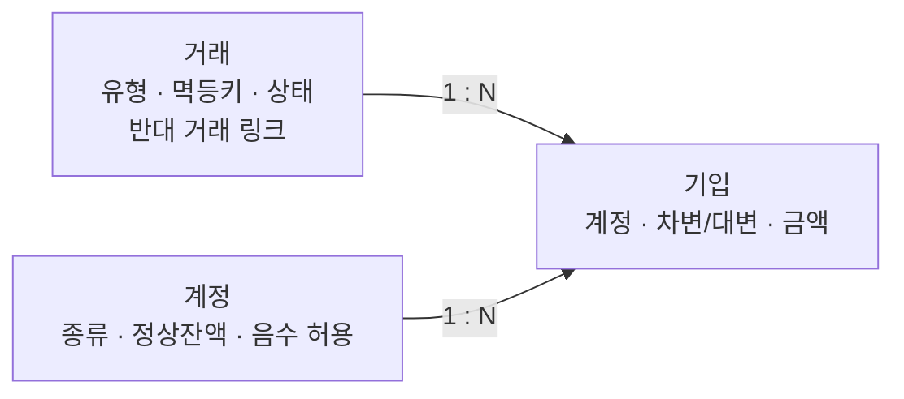
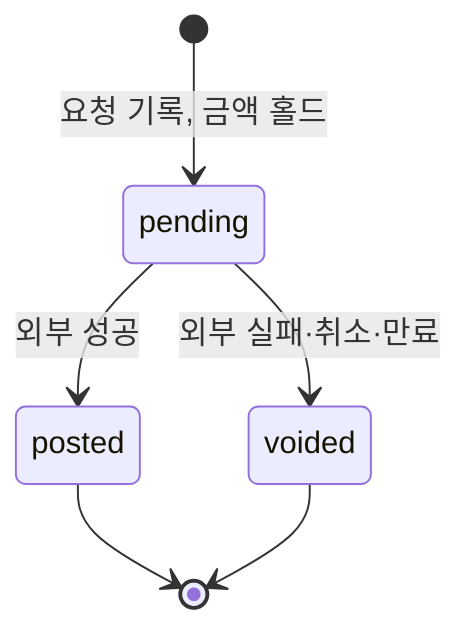

# 원장 개요와 동작 방식

## 쉬운 설명

용돈 기입장을 생각하면 된다. 남은 돈을 지우개로 고쳐 쓰지 않고 **한 줄씩 아래에 덧붙이기만** 한다. 그리고 돈이 어디서 와서 어디로 갔는지를 **양쪽 칸에 같은 금액으로** 적는다. 부모님 지갑이나 가게처럼 내 것이 아닌 곳도 칸을 하나씩 만들어 둔다. 그러면 모든 칸을 더했을 때 항상 맞아떨어지고, 틀린 곳은 위로 따라 올라가며 찾을 수 있다.

## 일반 설명

> 왜 이런 구조가 생겼는지는 [역사](./01-history.md), 설계를 고르는 기준은 [트레이드오프](./03-tradeoffs.md), 잘못 쓰는 패턴은 [흔한 함정](./04-pitfalls.md), 장애는 [장애 유형](./05-failure-modes.md). 세트 전체가 [2절 용어](#2-용어)를 따른다.

### 1. 무엇을 해결하나

원장(ledger)은 **값이 계정 사이를 옮겨 다닌 기록을 덧붙이기만 하는 저장소**다. 잔액은 따로 저장한 값이 아니라 이 기록에서 계산한 결과다. 은행만의 것이 아니다.

| 도메인 | 고객 쪽 계정 | 시스템 계정 (5절) | 옮겨지는 것 |
|---|---|---|---|
| 지갑·선불 충전 | 고객 지갑 | 회사 은행 계좌, PG 미수금, 수수료 | 돈 |
| 포인트·마일리지 | 회원 포인트 | 적립 비용, 사용 매출, 소멸 수익 | 포인트 |
| 재고 | 창고·매장 | 공급사, 판매 출고, 폐기 | 품목 수량 |
| 사용량 크레딧 | 고객 크레딧 | 충전 매출, 사용 처리 | 크레딧 |
| 마켓플레이스 | 판매자 정산금 | 구매 대금, 수수료 수익 | 돈 |

원장이 필요한 조건은 세 가지다: **양이 보존된다**(어디선가 빠지면 어딘가에 들어간다), **잔액에 규칙이 있다**(음수 금지 등), **이력이 근거다**(왜 이 잔액인지 설명할 수 있어야 한다). 옮겨지는 양이 없는 규칙("이메일 중복 금지", "좌석 하나에 한 명")은 유니크 제약으로 충분하다.

### 2. 용어

이 세트는 **용어** 열의 말로만 쓴다. 회계 용어가 있으면 그것을 쓰고, 실무·원장 서비스(Modern Treasury, TigerBeetle)에서 섞어 쓰는 이름은 **다르게 부르는 이름** 열에 모았다.

**구조**

| 용어 | 영어 | 다르게 부르는 이름 | 뜻 |
|---|---|---|---|
| 원장 | ledger | 레저, 불변 원장 | 기입을 덧붙이기만 하는 기록. 계정별 잔액의 원본 |
| 계정 | account | 계좌, 지갑(월렛), 잔고 | 값을 담는 칸. 은행 계좌, 지갑, 창고도 계정이다 |
| 시스템 계정 | system account | 내부 계정, 운영 계정, 시스템 지갑 | 고객이 아닌 계정: 자금, 청산, 수익·비용, 가계정 (5절) |
| 거래 | transaction | 트랜잭션(원장 서비스), 전송(TigerBeetle의 transfer) | 값이 옮겨진 사건 하나. DB의 transaction은 **트랜잭션**으로 구분한다 |
| 기입 | entry | 엔트리, 원장 엔트리(ledger entry), 분개 라인, 포스팅(Blnk·Beancount 등에서. 회계의 전기와 다른 뜻) | 거래가 한 계정에 남긴 한 줄. 테이블의 한 행 |
| 덧붙이기만 | append-only | 불변(immutable), 추가 전용 | 기입을 추가만 하고 고치거나 지우지 않음 |

**부기**

| 용어 | 영어 | 다르게 부르는 이름 | 뜻 |
|---|---|---|---|
| 부기 | bookkeeping | 장부 기록 | 거래를 계정별로 기입해 장부를 기록·정리하는 방법. 기입하는 범위에 따라 복식부기와 단식부기로 나뉜다 |
| 복식부기 | double-entry bookkeeping | 복식, 더블 엔트리 | 거래마다 차변 합 = 대변 합이 되도록 관련 계정 모두에 기입 |
| 단식부기 | single-entry bookkeeping | 단식, 싱글 엔트리 | 고객 쪽 계정에만 기입하고, 상대는 거래의 속성으로만 남김 |
| 차변 / 대변 | debit / credit | 데빗 / 크레딧 | 기입의 두 방향. 금액은 항상 양수이고 방향이 증감을 정한다 |
| 정상잔액 | normal balance | 계정 방향(normality) | 계정 잔액이 정상적으로 남는 쪽. 자산·비용은 차변, 부채·자본·수익은 대변 |
| 분개 | journal entry | 저널 엔트리, 전표(분개를 적은 증빙 문서) | 거래 하나를 차변·대변으로 나눠 적은 것 (거래 단위) |
| 전기 | posting (회계) | 포스팅 | 분개를 각 계정으로 옮겨 적는 일. 그 결과가 기입이다 |
| 시산표 | trial balance | — | 전체 계정의 차변 합 = 대변 합을 확인하는 표 |
| 반대 거래 | reversal | 역분개, 취소 거래, 리버설 | 틀린 거래를 지우지 않고 방향을 뒤집어 상쇄하는 거래 |

**잔액과 상태**

| 용어 | 영어 | 다르게 부르는 이름 | 뜻 |
|---|---|---|---|
| 거래 후 잔액 | balance after | 러닝 밸런스(running balance), 누적 잔액 | 그 기입이 반영된 직후의 계정 잔액 (정상잔액 방향) |
| 순번 | sequence | 시퀀스, 계정 버전 | 계정별 기입 번호. 마지막 기입 + 1 로 계산한다 |
| 대기 / 확정 / 취소 | pending / posted / voided | 보류 / 포스팅됨 / 보이드(void)·보관(archived) | 거래 상태. 여기서 posted는 회계의 전기가 아니라 "결과 확정"이다 |
| 홀드 | hold | 가승인(카드), 예약(reserved), 지급 보류 | 대기 거래로 금액을 묶어 사용 가능 잔액에서 빼 두는 것 |
| 확정 잔액 / 사용 가능 잔액 | posted / available balance | 출금 가능 잔액 | 확정 기입만의 잔액 / 확정 잔액 − 대기 중인 나가는 금액 |

**운영**

| 용어 | 영어 | 다르게 부르는 이름 | 뜻 |
|---|---|---|---|
| 대사 | reconciliation | 리컨실리에이션, 정산 대사 | 원장과 외부 기록(은행 명세, PG 정산 파일)을 맞춰 보는 일 |
| 청산 계정 | clearing account | 중간 계정, 정산 대기 계정 | 이동 중인 금액을 두는 시스템 계정. 이동이 끝나면 0으로 돌아온다 |
| 가계정 | suspense account | 미결산 계정, 서스펜스 계정 | 성격이 정해지지 않은 금액을 임시로 두는 계정 |
| 멱등키 | idempotency key | 아이뎀포턴시 키, 중복 방지 키 | 같은 요청을 한 번만 처리하게 하는 키 |
| 핫 계정 | hot account | 핫스팟 계정 | 쓰기가 몰려 처리량의 병목이 되는 계정 |

### 3. 구조와 불변성



| 요소 | 담는 것 |
|---|---|
| **계정** | 종류(고객, 자금, 청산, 수익·비용, 가계정), 정상잔액(차변·대변), 음수 허용 여부 |
| **거래** | 유형, 멱등키, 상태, 상쇄한 원래 거래(`reverses_tx_id`), 기록 시각 |
| **기입**(엔트리) | 계정, 방향(차변·대변), 금액(양수), 거래 참조 |

회계의 순서로 보면 거래를 차변·대변으로 나누는 것이 **분개**, 그것을 계정별로 옮겨 적는 것이 **전기**, 그 결과 각 계정에 남은 한 줄이 **기입**이다. 원장은 분개와 전기를 한 트랜잭션에서 한 번에 한다.

#### 3.1 확정된 기입은 고치지 않는다

덧붙이기만 하는 것은 선택지가 아니라 **원장의 정의**다. 기입을 `UPDATE`할 수 있으면 그것은 원장이 아니라 "잔액 테이블 + 변경 로그"이고, 잔액이 틀렸을 때 다시 계산할 원본이 없다. 그래서 약속이 아니라 **DB가 막게** 한다.

```sql
-- 애플리케이션 계정은 기입을 읽고 추가만 할 수 있다
GRANT SELECT, INSERT ON bank.entry TO 'app'@'%';

-- 권한이 넓은 계정·마이그레이션 스크립트의 실수도 막는다
CREATE TRIGGER entry_no_update BEFORE UPDATE ON entry FOR EACH ROW
  SIGNAL SQLSTATE '45000' SET MESSAGE_TEXT = 'entry is append-only';
CREATE TRIGGER entry_no_delete BEFORE DELETE ON entry FOR EACH ROW
  SIGNAL SQLSTATE '45000' SET MESSAGE_TEXT = 'entry is append-only';
```

DBA 권한으로 바꾼 것까지 잡아야 하는 감사 요구가 있으면, 각 기입에 이전 기입의 해시를 넣어 **변조를 사후에 탐지**할 수 있게 한다.

바뀌어도 되는 것은 아래 세 가지뿐이다. 모두 **원장 밖에 있거나 아직 확정되지 않은 것**이다.

| 예외 | 이유 | 더 엄격하게 하려면 |
|---|---|---|
| 대기 거래의 상태 (`pending` → `posted`·`voided`) | 결과가 확정되기 전. Modern Treasury도 "확정 후 불변"이다 | TigerBeetle처럼 확정·취소도 대기 거래를 가리키는 **새 거래**로 덧붙인다 |
| 계정 행의 잔액 캐시 | 원장이 아니라 파생 값. 틀리면 기입에서 다시 계산한다 | 캐시 없이 거래 후 잔액만 쓴다 (6절) |
| 개인정보 삭제 요구 | 법적 삭제 의무 | 기입에는 고객 ID만 두고 개인정보는 별도 테이블에 둔다 |

#### 3.2 정정은 반대 거래로

예: 고객 지갑 B로 들어온 은행 입금을 100으로 기록했는데 실제는 10이었다.

| 거래 | 유형 | 상쇄 대상 | 기입 |
|---|---|---|---|
| t1 | 입금 | — | 차변 회사 은행 계좌 100 / 대변 지갑 B 100 |
| t2 | 반대 거래 | t1 | 차변 지갑 B 100 / 대변 회사 은행 계좌 100 |
| t3 | 입금 | — | 차변 회사 은행 계좌 10 / 대변 지갑 B 10 |

- 지갑 B 잔액은 10이다. "100이 한때 기록됐고 t2로 상쇄됐다"는 사실이 그대로 남는다. 그 사이 B가 100을 근거로 출금했다면 왜 허용됐는지 설명할 수 있다.
- 기입을 `UPDATE`로 고쳤다면 t1이 처음부터 10이었던 것처럼 보이고, 이력은 따로 쌓는 로그(트리거 이력 테이블, CDC)에 기대야 한다. 로그는 쓰기의 부산물이라 빠질 수 있고, 원본과 다르면 어느 쪽이 맞는지 판단할 근거가 없다.
- **이력 조회가 곧 기입 조회다.** 특정 시점 잔액은 그 시점까지의 기입을 더한다.

```sql
SELECT t.id, t.type, t.reverses_tx_id, e.direction, e.amount, t.created_at
  FROM entry e JOIN tx t ON t.id = e.tx_id
 WHERE e.account_id = :wallet_b
 ORDER BY t.created_at, t.id;
```

여기서 시각(`created_at`)은 **조회·감사용**이다. 동시 쓰기의 충돌 판정에는 쓰지 않는다 → [흔한 함정 2절](./04-pitfalls.md#2-충돌을-못-잡는-번호).

### 4. 기록 범위: 잔액만, 단식부기, 복식부기

덧붙이기만 한다는 전제 위에서 정하는 것은 **거래 하나가 어느 계정에 기입을 남기나**다. 차이는 바깥(은행, PG)이 끼는 거래에서 드러난다.

예: 고객이 은행 이체로 지갑 B에 100을 입금했다.

| 방식 | 남는 것 | 할 수 있는 것 |
|---|---|---|
| **잔액만** | `account`: 지갑 B 잔액 100 | 현재 잔액뿐. 기입이 없으니 원장이 아니다 |
| **단식부기**(싱글 엔트리) | 기입: 대변 지갑 B 100<br>돈이 은행에서 왔다는 것은 거래의 속성(`source = 'bank'`)으로만 | 지갑 B 잔액을 기입에서 다시 계산 |
| **복식부기**(더블 엔트리) | 기입: 차변 회사 은행 계좌 100 / 대변 지갑 B 100 | 위에 더해, 거래마다 차변 합 = 대변 합 검사, 회사 은행 계좌 잔액을 은행 명세와 대사 |

- 단식부기와 복식부기의 차이는 **바깥을 계정으로 두느냐**다. 지갑 A → 지갑 B 이체처럼 양쪽이 모두 고객 계정이면 두 방식이 같은 기입을 남긴다.
- 복식부기에서는 거래에 출처·목적지 속성이 필요 없다. 기입이 말해 준다.
- 비교와 고르는 기준은 [트레이드오프 2절](./03-tradeoffs.md#2-단식부기-vs-복식부기).

### 5. 시스템 계정

복식부기는 거래마다 상대 계정이 있어야 하므로, **고객이 아닌 모든 상대를 시스템 계정으로 만든다.** 단위는 API 하나가 아니라 "값을 주고받는 상대 × 통화 × 용도"다.

| 종류 | 예 | 정상잔액 | 잔액의 의미 | 확인할 것 |
|---|---|---|---|---|
| **고객** | 지갑, 포인트, 판매자 정산금 | 대변 (회사가 돌려줄 돈 = 부채) | 고객 몫 | 음수 금지 |
| **자금** | 회사 은행 계좌, PG 예치금 | 차변 (자산) | 외부 기관에 있는 회사 돈 | 은행 명세와 **일치** |
| **청산** | PG 미수금, 출금 진행 중 | 차변 (자산) | 이동 중인 돈 | 정산이 끝나면 **0으로 복귀** |
| **수익·비용** | 수수료 수익, PG 수수료 비용, 적립 비용 | 수익은 대변, 비용은 차변 | 회사가 벌거나 쓴 돈 | 기간별 합계 |
| **가계정** | 대사 불일치 보관 | — | 원인을 조사 중인 금액 | **0이 목표** |

예: 고객이 카드로 지갑 A에 10,000 충전 → 며칠 뒤 PG가 수수료 300을 떼고 정산.

| 시점 | 차변 | 대변 |
|---|---|---|
| 충전 | PG 미수금 10,000 | 지갑 A 10,000 |
| 정산 | 회사 은행 계좌 9,700<br>PG 수수료 비용 300 | PG 미수금 10,000 |

- 정산 뒤 **PG 미수금은 0**으로 돌아온다. 0이 아니면 정산되지 않은 돈이 남았다는 뜻이고, 대사의 출발점이 된다 → [장애 유형 4절](./05-failure-modes.md#4-외부-대사-불일치).
- 회사 은행 계좌는 거의 모든 입출금에 끼어 **핫 계정**이 된다. 직렬화할 필요가 없는 계정이라 그렇게 푼다 → [트레이드오프 3.3](./03-tradeoffs.md#33-핫-계정).

### 6. 잔액

잔액은 정상잔액 방향으로 계산한다.

| 계정의 정상잔액 | 잔액 |
|---|---|
| 차변 (자산·비용) | 차변 합 − 대변 합 |
| 대변 (부채·자본·수익) | 대변 합 − 차변 합 |

매번 더하면 느리므로 실무는 셋 중 하나를 고른다 (비교는 [트레이드오프 4절](./03-tradeoffs.md#4-잔액을-어떻게-얻나)).

| 방식 | 현재 잔액 | 잔액 규칙(음수 금지) 검사 |
|---|---|---|
| 매번 합계 | 위 식으로 합계 | 합계와 쓰기 사이에 다른 쓰기가 끼어든다 |
| 기입에 **거래 후 잔액** | 그 계정의 마지막 기입 | `CHECK (balance_after >= 0)` |
| 계정 행에 **잔액 캐시** | `account.balance` | 조건부 `UPDATE ... WHERE balance >= :amt` |

### 7. 상태: 대기 → 확정

외부(카드사, PG, 배송)가 끼면 결과가 나중에 확정된다. 그동안은 금액을 **홀드**한다.



| 잔액 | 뜻 | 쓰는 곳 |
|---|---|---|
| 확정 잔액 | 확정 기입만의 잔액 | 정산·보고 |
| 사용 가능 잔액 | 확정 잔액 − 대기 중인 **나가는** 금액 | 새 출금·결제 허용 판단 |

대기 중인 **들어오는** 금액은 사용 가능 잔액에 넣지 않는다. 확정 전의 입금을 써 버리면, 입금이 취소됐을 때 되돌릴 곳이 없다.

### 8. 기본 흐름

예: 지갑 A에서 100 출금(회사 은행 계좌에서 고객 은행 계좌로 송금).

1. **멱등키**로 같은 요청이 이미 처리됐는지 본다. 있으면 그 결과를 돌려준다.
2. 지갑 A의 마지막 기입(순번, 거래 후 잔액)을 읽는다.
3. 한 트랜잭션에 거래 1행과 기입 2행(차변 지갑 A 100 / 대변 회사 은행 계좌 100)을 쓴다. 지갑 A 기입에는 다음 순번과 거래 후 잔액을 넣는다.
4. 같은 순번을 누가 먼저 썼으면 중복 키 오류 → 2부터 다시. 잔액이 모자라면 `CHECK` 위반 → 거절.
5. 외부 송금이 끼면 대기로 먼저 기록하고, 결과에 따라 확정 또는 취소한다.

SQL 전체와 동시성 처리는 [트레이드오프 3절](./03-tradeoffs.md#3-동시성-제어-분산-락이-뚫려도-정확하게).

## 관련 문서

- [원장의 역사](./01-history.md)
- [원장 트레이드오프와 선택 기준](./03-tradeoffs.md)
- [원장 사용 시 흔한 함정과 해결 방법](./04-pitfalls.md)
- [원장 장애 유형과 대응](./05-failure-modes.md)
- [락 장애 유형 — 고가용성 구성과 분산 락·DB 역할](../../cs/0001-lock/05-failure-modes.md#8-락-서비스-중단과-고가용성-구성)

## 참고 자료

- [Modern Treasury — Guide to Debits and Credits](https://docs.moderntreasury.com/docs/guide-to-debits-and-credits)
- [Modern Treasury — Transaction Status and Balances](https://docs.moderntreasury.com/docs/transaction-status-and-balances)
- [Modern Treasury — Ledger Transaction object (reverses / reversed_by)](https://docs.moderntreasury.com/reference/ledger-transaction-object)
- [TigerBeetle — Transfer](https://docs.tigerbeetle.com/reference/transfer)
- [TigerBeetle — Two-Phase Transfers](https://docs.tigerbeetle.com/coding/two-phase-transfers/)
- [Fragment — Design your ledger (청산 계정)](https://fragment.dev/docs/design-your-ledger)
- [Martin Fowler — Accounting Entry](https://martinfowler.com/eaaDev/AccountingEntry.html)
- [Normal balance (Wikipedia)](https://en.wikipedia.org/wiki/Normal_balance)
